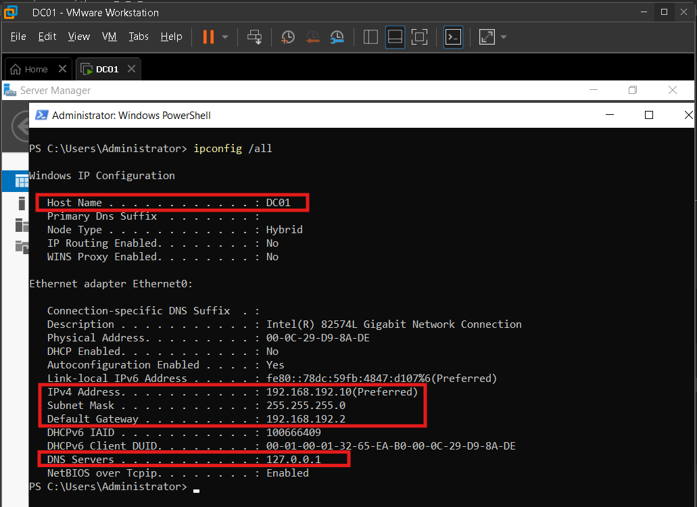
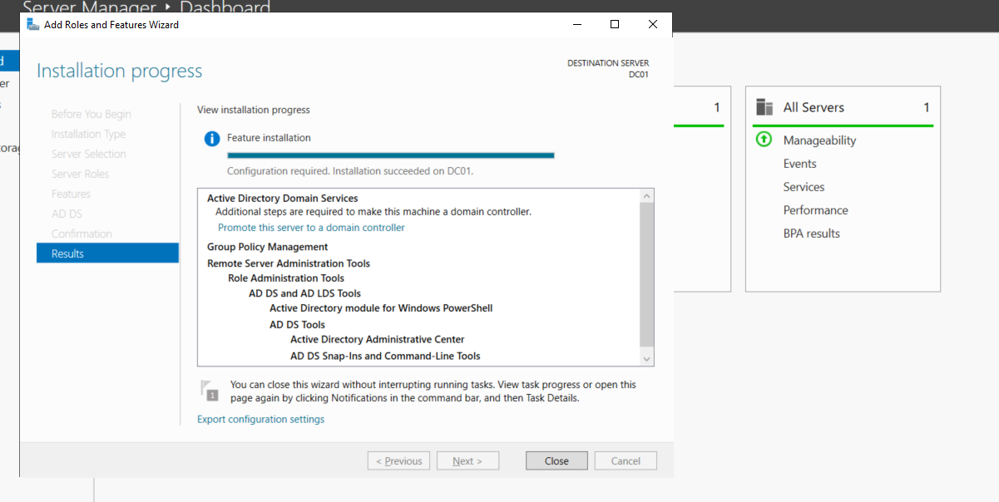
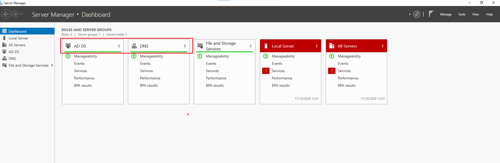
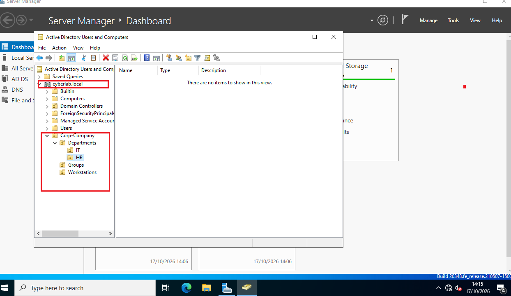
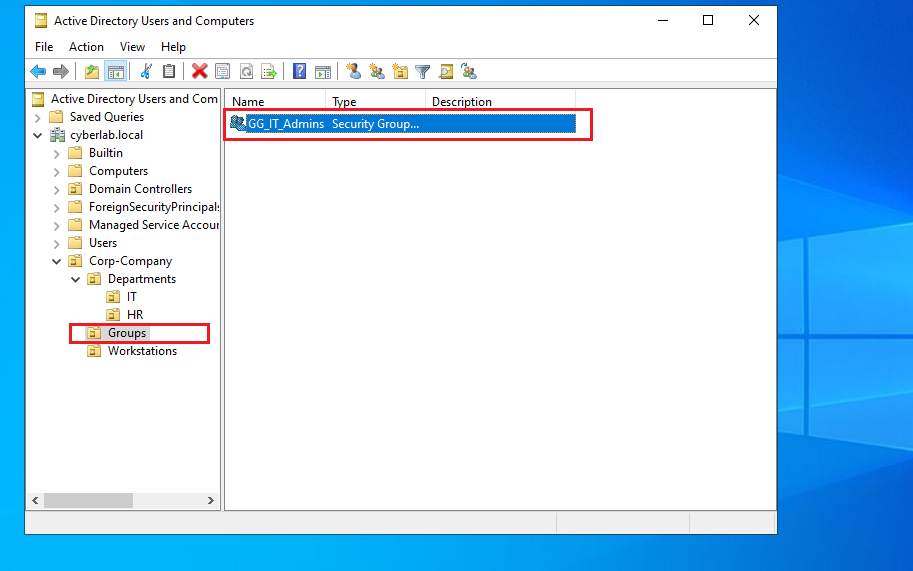
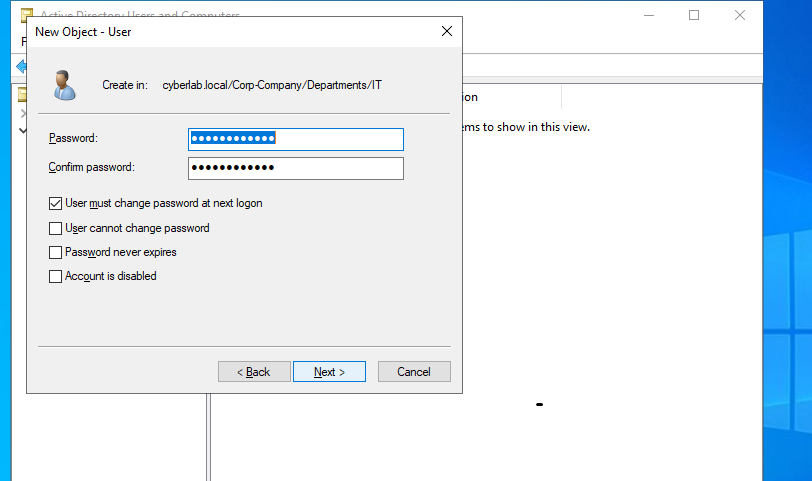
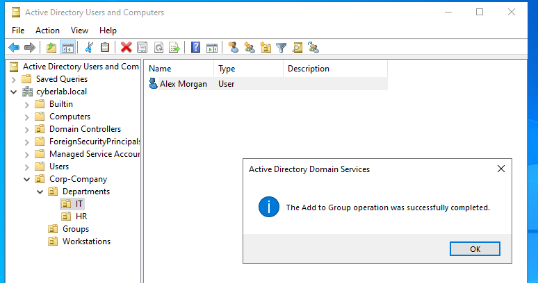
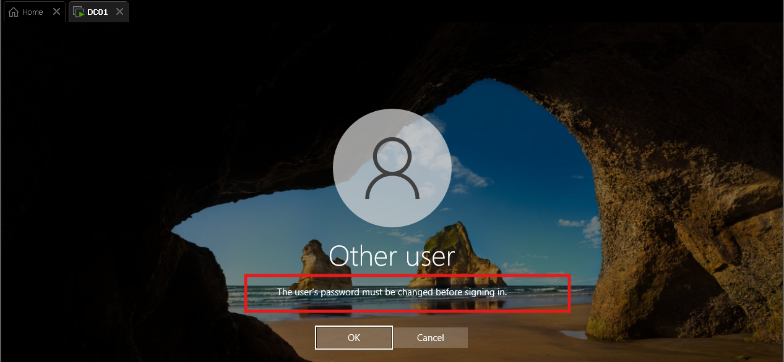

# Enterprise Active Directory Domain Services Deployment & Identity Governance Lab

## Executive Summary
This project demonstrates the deployment, configuration, and security hardening of an Active Directory Domain Services (AD DS) environment hosted on Windows Server 2022. The lab models enterprise identity and access management (IAM) best practices, including tiered Organizational Unit (OU) architecture, Role-Based Access Control (RBAC) security groups, and automated credential hygiene enforcement workflows.

## Environment Architecture & Specifications
* **Operating System:** Windows Server 2022 Standard Evaluation (Desktop Experience)
* **Hypervisor:** VMware Workstation
* **Domain Name (FQDN):** `cyberlab.local`
* **NetBIOS Domain Name:** `CYBERLAB`
* **Domain Controller Hostname:** `DC01`
* **Network Configuration:** Static IPv4 `192.168.192.10/24`, Gateway `192.168.192.2`, DNS `127.0.0.1`

---

## Technical Implementation

### 1. Host Hardening & Static Network Configuration
Prior to AD DS promotion, the server was assigned a static IP and renamed to the enterprise standard naming convention `DC01`. Pointing the primary DNS resolver to `127.0.0.1` ensures local resolution of Active Directory SRV records.

### 2. Active Directory Domain Services & DNS Promotion
AD DS and integrated DNS server roles were installed. The server was promoted as the root Domain Controller for a new forest (`cyberlab.local`).

### 3. Tiered Organizational Unit (OU) Design
To avoid flat Active Directory structures and apply the Principle of Least Privilege, a tiered OU hierarchy was implemented under `Corp-Company`:
* `Departments/`: Departmental divisions (`IT`, `HR`)
* `Groups/`: Global security groups for RBAC
* `Workstations/`: Domain computer endpoints
* Containers were protected against accidental deletion.

### 4. Role-Based Access Control (RBAC) Security Groups
Global security groups were provisioned to eliminate direct privilege assignment to user accounts:
* `GG_IT_Admins`: Administrative team members
* `GG_HR_Staff`: Human resources personnel

### 5. Account Provisioning & Credential Hygiene Enforcement
A standard user account (`amorgan` - Alex Morgan) was provisioned and assigned to `GG_IT_Admins`. To mitigate credential exposure during initial onboarding, the **"User must change password at next logon"** flag was enforced.

### 6. Authentication & Policy Verification
Authentication was initiated against the domain for `cyberlab\amorgan`. Active Directory successfully intercepted the authentication sequence, rejected standard logon, and required immediate password reset before access was granted.

---

## Cybersecurity & Threat Mitigation Analysis

* **Next-Logon Password Change:** Mitigates temporary credential interception and unauthorized initial access. Ensures IT-issued onboarding passwords are immediately invalidated upon initial use, eliminating cleartext credential exposure risks.

* **Granular OU Hierarchy:** Mitigates excessive GPO scope and unauthorized directory traversal. Enables targeted Group Policy Objects (GPOs) and granular administrative delegation without granting broad domain administrator privileges.

* **Security Groups (RBAC):** Mitigates privilege creep and token bloat. Enforces least-privilege resource access by binding permissions strictly to verified functional roles rather than directly to individual user accounts.

---

## Key Skills Demonstrated
* Windows Server 2022 administration & networking fundamentals
* Active Directory Domain Services (AD DS) forest deployment
* Identity and Access Management (IAM) governance
* Credential lifecycle management and onboarding workflows
* Role-Based Access Control (RBAC) architecture
